# 42Cards

A profile card for any [42](https://42.fr) login, served as an SVG you can drop into a README:

```markdown

```

Each card shows the avatar, campus, cursus, grade and a level progress bar. There are **12 themes**:

| | | |
|---|---|---|
|  |  |  |
|  |  |  |
|  |  |  |
|  |  |  |

*(Samples are rendered from a fixture, not a real student.)*

## Why this exists

The popular [badge42](https://github.com/oakoudad/badge42) card was a closed-source hosted service. It went down and nobody could fix it. 42Cards is a small open-source rebuild: pure SVG, no dependencies, and a design that survives the server disappearing (see [Self-hosting](#self-hosting)).

## API

`GET /card/<login>?theme=<theme>`

- `login`: 42 intra login (`a-z 0-9 _ -`, up to 30 chars).
- `theme`: one of the 12 above. Default `kettlebells`.
- Always returns an SVG with status 200 for valid input, including a readable "Unknown login" / "Busy" card, so READMEs never show a broken image. Invalid `login` or `theme` returns 400.
- Responses are cached on the CDN for an hour.

`/` is a small page that previews every theme for a login and gives you the Markdown.

## Privacy

Only public profile data is shown. **Email and real name are not part of the data model**, so they cannot appear on any card. Logins are validated before they reach the 42 API.

## How it works

```
GET /card/<login>?theme=…
  -> api/card.py              Vercel handler (headers, caching)
  -> cards42.service          validate login/theme, small in-memory cache
  -> cards42.api              42 API: client-credentials token + /v2/users/<login> + avatar
  -> cards42.profile          raw JSON -> Profile (public fields only)
  -> cards42.render + theme   Profile + src/cards42/themes/<name>.toml -> SVG
```

- Zero runtime dependencies (Python standard library only).
- Cards are pure SVG (no HTML or `foreignObject`, no external references). The avatar is embedded because an SVG shown through `` cannot load external images.
- Themes are data: one TOML file each in `src/cards42/themes/` (`bg`, `text`, `accent`, `track`, optional `art`). Backgrounds like `binary` and `water` are generated vector art, so each card is only a few KB.
- **Avatars:** the 42 image CDN rejects non-browser clients (HTTP 403), so the avatar is embedded only when the download succeeds. Otherwise the card shows a placeholder with the login's initial.
- Cards animate on load and respect `prefers-reduced-motion`.

## Run locally

Requires Python 3.11+.

```bash
python -m venv .venv && . .venv/bin/activate
pip install -r requirements-dev.txt
pytest                                   # 35 tests, no network needed

cp .env.example .env                     # then fill in FT_UID and FT_SECRET
python -m cards42 <login> water > card.svg
python -m cards42 --raw <login>          # dump the raw 42 API response
python scripts/samples.py                # re-render docs/samples/ from the fixture
```

You need a 42 API application (intra → Settings → API) with only the default
**"Access the user public data"** scope. Any redirect URI works (for example
`http://localhost:3000/callback`) because only the client-credentials flow is used.

## Deploy (Vercel)

1. Import this repo in Vercel (framework preset: **Other**).
2. Add environment variables `FT_UID` and `FT_SECRET`.
3. Deploy. `vercel.json` already maps `/card/:login` to the function.

**Region matters.** The 42 API sits behind Cloudflare, which answers a bot challenge ("Just a moment...", HTTP 403) to requests from some cloud regions. From Vercel's default `iad1` (Washington) every call was challenged; from `cdg1` (Paris, set in `vercel.json`) it works. If cards suddenly show `42 API error: HTTP 403`, that is the cause. Do not try to bypass the challenge, change region or host instead.

The 42 API allows about 2 requests/second and 1200/hour per application, shared by everyone. Two layers protect that budget:
CDN caching (`s-maxage=3600`) and a 10-minute in-memory profile cache, so trying all themes for a login costs one API call.
Per-IP rate limiting is **not** done in code (serverless instances do not share memory). Add a rate-limit rule in the
Vercel dashboard (Firewall) if you expect abuse.

## Self-hosting

It is one stateless function plus static files. Anything that can run `api/card.py`'s `respond()` works. To avoid running a
server entirely, render a single card with `python -m cards42 <login> <theme> > card.svg` on a schedule and commit the file.

## Add a theme

Create `src/cards42/themes/<name>.toml`:

```toml
bg = "#101820"
text = "#ffffff"
accent = "#fee715"
track = "#2b3a4a"
```

Tests pick it up automatically (valid XML, small, self-contained).

## License

MIT
